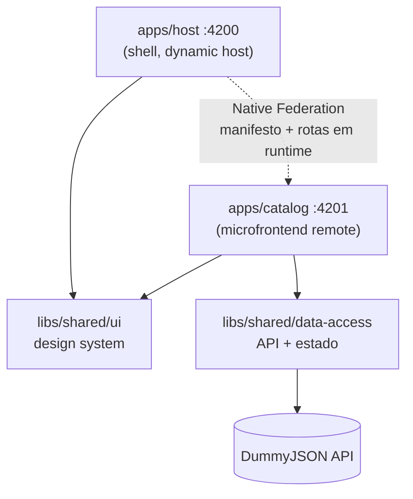

<div align="center">

# Maison Rosé · Enterprise MFE

**Vitrine de produtos com microfrontends em Angular, Native Federation e um design system próprio.**


</div>

## Por que construí este projeto

Construí o Maison Rosé para mostrar, com código real e decisões documentadas, o que eu entrego numa posição de **frontend pleno ou sênior**:

- **Microfrontends com Native Federation:** dois apps Angular independentes (host e catalog) compostos em tempo de execução, sem o host importar uma linha do catalog.
- **Consumo de API com estado reativo:** dados reais do [DummyJSON](https://dummyjson.com), com RxJS para o transporte e Signals para o estado, num scroll infinito robusto a cliques repetidos e a falhas de rede.
- **Arquitetura que escala em equipe:** monorepo Nx com fronteiras entre camadas garantidas pelo lint, APIs públicas explícitas e um design system desacoplado do domínio.
- **Qualidade verificável:** testes que cobrem os cenários difíceis (concorrência, erro, fallback do microfrontend) e performance medida no build de produção.

O projeto foi construído em fases, com um commit por passo e o motivo de cada decisão registrado em [docs/decisoes-tecnicas.md](docs/decisoes-tecnicas.md).

## Destaques

| | |
|---|---|
| 🧩 **Native Federation** | O host lê um manifesto em tempo de execução e monta as rotas expostas pelo catalog. Trocar o endereço do microfrontend não exige rebuild. |
| 🛡️ **Resiliência** | Se o catalog cair, o host continua no ar e mostra uma página de aviso com "Tentar de novo". |
| ♾️ **Scroll infinito correto** | `exhaustMap` impede páginas duplicadas ou perdidas; erros mantêm os itens na tela e a nova tentativa repete a mesma página. |
| 🎨 **Design system próprio** | Tokens em variáveis CSS, componentes sem conhecimento de domínio e uma diretiva de scroll infinito reutilizável. |
| 🧱 **Fronteiras pelo lint** | Tags `type:*` e `scope:*` impedem, por exemplo, que a lib de UI importe a camada de dados. |
| ⚡ **Performance medida** | Lighthouse no build de produção: desktop 88 de performance, CLS 0 e SEO 100 (detalhes abaixo). |

## Telas

| Desktop | Celular | Catalog fora do ar |
|---|---|---|
|  |  |  |

## Arquitetura



- **Host** (`apps/host`): casca da aplicação (layout, marca, rodapé). Lê `federation.manifest.json` e monta na raiz as rotas que o catalog expõe (`./routes`).
- **Catalog** (`apps/catalog`): a vitrine. Roda sozinho em `:4201` ou dentro do host.
- **`shared/data-access`**: `ProductsApi` (HTTP) e `ProductsStore` (estado). Só o store é público.
- **`shared/ui`**: `Button`, `Badge`, `Card`, diretiva `InfiniteScroll` e o tema.
- Angular, RxJS e as libs são **singletons compartilhados** entre host e catalog: existe uma única instância do store.

## Decisões técnicas em destaque

**1. O host recebe o carregador da federação por injeção de dependência.** O `loadRemoteModule` avulso está deprecado; usar o carregador devolvido pelo `initFederation` deixa a rota testável com um carregador falso, e a falha vira uma página de aviso em vez de uma tela em branco.

```ts
export function loadCatalogRoutes(): Promise<Route[]> {
  return inject(REMOTE_LOADER)('catalog', './routes')
    .then((remote) => (remote as { routes: Route[] }).routes)
    .catch(() => [{ path: '**', component: RemoteUnavailable }]);
}
```

**2. Scroll infinito com `exhaustMap` e `skip` derivado do estado.** Pedidos feitos durante uma carga são ignorados (o `switchMap` cancelaria e perderia páginas). Como o próximo `skip` é sempre a quantidade de itens já carregados, uma nova tentativa depois de um erro repete exatamente a página que falhou.

```ts
this.loadMoreRequests
  .pipe(exhaustMap(() => this.fetchNextPage()), takeUntilDestroyed())
  .subscribe();
```

Um teste de mutação confirmou a garantia: trocando `exhaustMap` por `mergeMap`, o teste "ignora pedidos durante a carga" falha.

**3. A detecção de rolagem fica na UI; a decisão de carregar fica no app.** A diretiva `uiInfiniteScroll` só avisa que a sentinela se aproximou da tela (`IntersectionObserver`); a página chama `store.loadMore()`. O store continua testável sem DOM, e a diretiva serve para qualquer lista.

**4. Native Federation em vez do Module Federation do Nx.** No Nx 23, os geradores de Module Federation para Angular estão deprecados e saem no Nx 24. Migrei o host de webpack para esbuild e adotei o Native Federation, que é a recomendação oficial.

A lista completa, com o motivo de cada escolha, está em [docs/decisoes-tecnicas.md](docs/decisoes-tecnicas.md).

## Performance

Lighthouse 12 no **build de produção**, servido localmente (host e catalog):

| Perfil | Performance | Acessibilidade | Boas práticas | SEO | LCP | CLS |
|---|---|---|---|---|---|---|
| Desktop | **88** | 95 | 100 | 100 | 2,1 s | **0** |
| Celular (4G simulado) | 61 | 95 | 96 | 100 | 10,8 s | **0** |

O que a medição mostrou e o que foi corrigido:

- **CLS de 0,813 para 0:** o conteúdo centralizado pulava de lado quando a barra de rolagem aparecia (`scrollbar-gutter: stable` resolveu), e o rodapé pulava quando a vitrine chegava (o conteúdo ganhou altura mínima de uma tela).
- **Imagem principal sem atraso:** a primeira linha de produtos deixou de usar `loading="lazy"` e ganhou prioridade alta; a API e o CDN de imagens recebem `preconnect`.
- **Trade-off conhecido no celular:** sob 4G simulado, a cadeia da federação (manifesto → `remoteEntry` → módulos compartilhados → rotas → API → imagens) ainda pesa no LCP. Os próximos passos estão no roadmap abaixo.

## Qualidade

- **30 testes unitários** (Jest): store com dublê de API controlado pelo teste, página com o store real e HTTP interceptado, diretiva com `IntersectionObserver` falso, rota remota com carregador falso e fallback.
- **Nenhum teste depende de rede:** o HTTP é interceptado com `HttpTestingController`.
- **Lint com fronteiras de módulo** em todos os projetos, comprovadas com um import proibido de teste.
- **Tipos conferidos contra a API real:** dos 194 produtos, 92 não têm `brand`, então o campo é opcional e a interface trata a ausência.

## Stack

| Ferramenta | Uso |
|---|---|
| Angular 22 | Standalone Components, Signals, `OnPush`, builder esbuild (`@angular/build`) |
| Native Federation 22.1 | Microfrontends em tempo de execução |
| Nx 23 | Monorepo, geradores, cache, grafo e fronteiras de módulo |
| RxJS 7.8 | HTTP e controle de concorrência |
| TypeScript 6 | `strict` nas libs |
| Jest 30 | Testes unitários |
| SCSS + variáveis CSS | Tema e tokens do design system |

## Como rodar

Pré-requisitos: Node 24 e npm.

```bash
npm ci
```

Suba os dois apps, cada um no seu terminal, e abra http://localhost:4200:

```bash
npx nx serve catalog
```

```bash
npx nx serve host
```

| Tarefa | Comando |
|---|---|
| Catalog sozinho | http://localhost:4201 (com `nx serve catalog` rodando) |
| Build de produção | `npx nx run-many -t build -p host catalog` |
| Todos os testes | `npx nx run-many -t test` |
| Lint | `npx nx run-many -t lint` |
| Grafo de dependências | `npx nx graph` |

## Estrutura

```
apps/
  host/                  # shell (dynamic host)
  catalog/               # microfrontend da vitrine (remote)
    src/app/products/    # página de produtos com scroll infinito
libs/
  shared/
    ui/                  # @enterprise/shared/ui: componentes, diretiva e tema
    data-access/         # @enterprise/shared/data-access: API e estado
docs/
  decisoes-tecnicas.md   # todas as decisões, com o motivo
  media/                 # GIF e capturas deste README
```

## O que vem por aí

O próximo passo é transformar a vitrine num **e-commerce de verdade**.

### 🛒 Carrinho

- **Estado compartilhado entre microfrontends:** um `CartStore` numa lib `shared/data-access`, com Signals, compartilhado como singleton. O catalog adiciona itens e o ícone do carrinho no cabeçalho do host atualiza na hora, sem os apps se importarem diretamente.
- **Persistência local:** o carrinho sobrevive a um recarregamento da página.
- **Integração com a API:** o DummyJSON tem endpoints de carrinho (`/carts`) que simulam as operações, o que permite exercitar o fluxo completo com requisições reais.

### 💳 Checkout

- **Um terceiro microfrontend (`checkout`):** formulário de entrega e pagamento simulados, com validação, resumo do pedido e tela de confirmação.
- **Mais um teste da arquitetura:** o host passa a compor dois remotes, com o carrinho compartilhado entre eles e o mesmo comportamento de fallback se algum ficar fora do ar.

### 🏷️ Filtro por categoria

Hoje a API devolve tudo na mesma lista, de sofá a peixe. O DummyJSON organiza os produtos em **24 categorias** e tem uma rota por categoria (`/products/category/{slug}`). O plano:

- **Filtro na URL** (`?categoria=furniture`), para o link ser compartilhável e o botão voltar do navegador funcionar.
- **Troca de filtro com `switchMap`:** ao mudar de categoria, a lista é zerada e a busca da categoria anterior é cancelada. É o caso em que o `switchMap` é o operador certo, ao lado do `exhaustMap` que já protege a paginação.
- **Componente de filtro no design system,** sem conhecer o domínio, como os demais.

### Engenharia

- [ ] Rodar os testes e2e (Cypress) com host e catalog no ar
- [ ] Reduzir o LCP no celular: pré-carregar o `remoteEntry`, hospedar as fontes e avaliar SSR
- [ ] Pipeline de CI com `nx affected`
- [ ] Ligar o `strict` do TypeScript em todo o workspace

---

<div align="center">

Feito por **Yasmin** · [github.com/ysobarbosa](https://github.com/ysobarbosa)

Dados de produtos: [DummyJSON](https://dummyjson.com). Projeto de estudo e portfólio.

</div>
