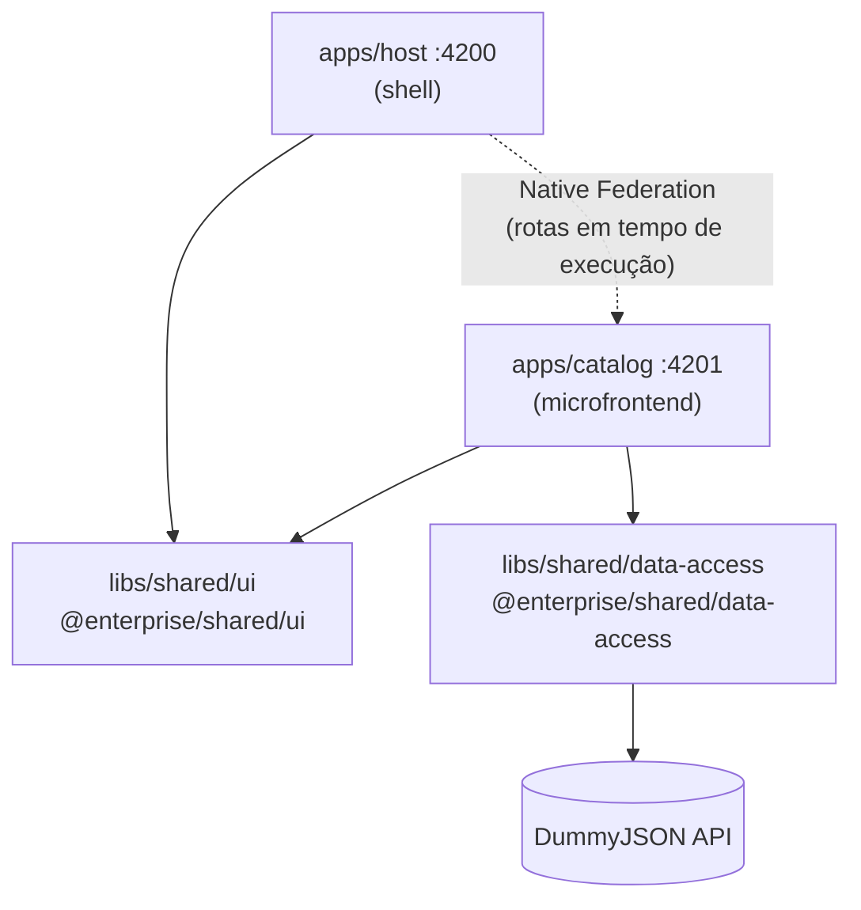

# Enterprise MFE

Monorepo **Nx + Angular** com arquitetura de **microfrontends** (Host + Catalog), consumindo a API pública do [DummyJSON](https://dummyjson.com).

É um projeto de estudo: a ideia é construir, passo a passo, uma base no estilo "enterprise" e registrar **o porquê** de cada decisão, não só o resultado. Cada etapa vira um commit pequeno, e este README é atualizado conforme o projeto avança.

## A ideia

Uma vitrine de produtos dividida em duas aplicações independentes:

- **Host:** a casca da aplicação (layout, navegação). Carrega os microfrontends em tempo de execução.
- **Catalog:** o microfrontend da listagem de produtos, com scroll infinito.

As duas compartilham código por meio de **libs** do monorepo:

- **`shared/data-access`:** acesso à API e estado (RxJS + Signals).
- **`shared/ui`:** Design System, com componentes visuais desacoplados das regras de negócio.



O host não importa código do catalog: ele só conhece o nome do remote e o endereço do `remoteEntry.json`, que ficam em `apps/host/public/federation.manifest.json`. O catalog expõe suas rotas (`./routes`), e o host as monta na raiz. Angular, RxJS e as libs do monorepo são compartilhados como singletons, então os dois apps usam a mesma instância do `ProductsStore`.

## Stack

| Ferramenta | Versão | Uso |
|---|---|---|
| Nx | 23.3 | Monorepo, geradores, cache e grafo de dependências |
| Angular | 22.1 | Standalone Components, Signals, change detection `OnPush`, builder esbuild |
| Native Federation | 22.1 | Microfrontends (`@angular-architects/native-federation`) |
| TypeScript | 6.0 | `strict` ligado nas libs |
| RxJS | 7.8 | Requisições HTTP e controle de concorrência |
| Jest | 30 | Testes unitários |
| Cypress | 16 | Testes e2e |
| Node | 24 | Runtime |

## Estrutura

```
apps/
  host/                  # aplicação shell (dynamic host)
  host-e2e/              # testes e2e (Cypress) do host
  catalog/               # microfrontend da vitrine (remote)
    src/app/products/    # página de produtos com scroll infinito
  catalog-e2e/           # testes e2e (Cypress) do catalog
libs/
  shared/
    ui/                  # @enterprise/shared/ui (componentes e src/styles/theme.scss)
    data-access/         # @enterprise/shared/data-access
      src/lib/products/  # modelos e cliente da API de produtos
```

As libs são importadas sempre pelo alias (`@enterprise/...`), nunca por caminho relativo. Os aliases ficam em `paths` no `tsconfig.base.json` e são criados pelos geradores do Nx. Cada lib expõe apenas o que está no seu `src/index.ts`.

## Como rodar

Pré-requisitos: Node 24 e npm.

```bash
npm ci
```

Para ver a aplicação completa, suba os dois apps, cada um no seu terminal, e abra http://localhost:4200:

```bash
npx nx serve catalog
```

```bash
npx nx serve host
```

Se o catalog estiver fora do ar, o host continua funcionando e mostra um aviso no lugar da vitrine. O catalog também abre sozinho em http://localhost:4201 (modo standalone).

| Tarefa | Comando |
|---|---|
| Build de produção | `npx nx build host` / `npx nx build catalog` |
| Testes de um app | `npx nx test host` / `npx nx test catalog` |
| Testes de uma lib | `npx nx test shared-ui` / `npx nx test shared-data-access` |
| Todos os testes | `npx nx run-many -t test` |
| Lint | `npx nx run-many -t lint` |
| Grafo de dependências | `npx nx graph` |

## Progresso

- [x] **Fase 1: base do workspace.** Workspace Nx criado, componente de exemplo removido, build e testes verdes.
- [x] **Fase 2: libs compartilhadas.** `shared/ui` e `shared/data-access` geradas com o Nx; alias `@enterprise/shared/ui` validado no build, no Jest e no grafo do Nx.
- [x] **Fase 3: camada de dados**
  - [x] Modelos de produto tipados a partir da resposta real da API
  - [x] `ProductsApi`: cliente HTTP paginado, com testes
  - [x] `ProductsStore`: estado com Signals e scroll infinito, com testes
  - [x] Consumo no host, com o alias `@enterprise/shared/data-access` validado no build, no Jest e no grafo do Nx
- [x] **Fase 4: Design System** em `shared/ui`
  - [x] Fronteiras entre camadas garantidas pelo ESLint (tags `type:*` e `scope:*`)
  - [x] Tokens de design (cores, tipografia, raios, sombras, movimento) como variáveis CSS
  - [x] Componentes `Button`, `Badge` e `Card` e diretiva `InfiniteScroll`, com testes
  - [x] Vitrine "Maison Rosé" no host, com scroll infinito automático
- [x] **Fase 5: microfrontend Catalog**
  - [x] Host migrado do builder webpack para o esbuild (`@angular/build`)
  - [x] App `catalog` gerado e configurado como remote do Native Federation
  - [x] Host como dynamic host, carregando as rotas do catalog pelo manifesto
  - [x] Vitrine movida do host para o catalog
  - [x] Host resiliente: aviso no lugar da vitrine quando o catalog não responde

## Decisões-chave

### Monorepo e libs
- **Libs não buildable:** o host compila o código-fonte das libs direto, via `paths`. É mais simples para libs internas, e o Native Federation compartilha o código delas entre host e catalog.
- **Geradores do Nx sempre que existirem**, para criar libs e aliases de forma consistente. Os defaults do gerador foram fixados no `nx.json` (Jest, ESLint, SCSS). Na versão instalada, o padrão de testes para libs não buildable seria Vitest, e o monorepo usa Jest.
- **`strict` só nas libs, por enquanto:** código novo já nasce com tipagem rigorosa; ligar o `strict` no restante do workspace é uma tarefa separada.
- **API pública explícita:** o `index.ts` de cada lib usa exports nomeados (`export type` para tipos) em vez de `export *`, para que nada interno vaze por acidente.
- **Esbuild em todos os apps:** o host começou em webpack, pensando no Module Federation do Nx. Na Fase 5, ele foi migrado para o esbuild (veja abaixo).

### Camada de dados (Fase 3)
- **Tipos conferidos contra a API real:** `brand` falta em cerca de metade dos produtos, então é opcional; `availabilityStatus` é um union dos três valores que a API devolve. Todos os campos são `readonly`.
- **`@Service()` em vez de `@Injectable`:** é o padrão do Angular 22. O serviço se registra sozinho na injeção de dependências, e as dependências entram via `inject()`.
- **Sem `provideHttpClient()`:** no Angular 22, o `HttpClient` já é fornecido no root e usa `fetch` por padrão.
- **API e estado separados:** o `ProductsApi` só descreve a requisição (devolve um `Observable` e repassa erros); o `ProductsStore` guarda o estado e decide quando buscar.
- **O store é a única porta de entrada:** a lib exporta os tipos de produto e o `ProductsStore`; o `ProductsApi` é interno. Assim, nenhuma tela consegue montar uma lista paralela à do store, e a implementação HTTP pode mudar sem quebrar quem consome.
- **Scroll infinito com `exhaustMap`:** novos pedidos de "carregar mais" são ignorados enquanto uma carga está em andamento, o que evita páginas perdidas ou duplicadas. O `skip` vem sempre da quantidade de itens já carregados, então uma nova tentativa depois de um erro repete a mesma página.
- **Detectar o fim da rolagem é papel da UI:** um `IntersectionObserver` numa diretiva da `shared/ui`. O store só expõe `loadMore()` e `hasMore()`, e é testável sem DOM.
- **Página de produtos validada no host primeiro:** a `ProductsPage` nasceu no host para testar a camada de dados de ponta a ponta, e foi movida para o catalog na Fase 5, com histórico preservado (`git mv`).
- **Custo da primeira rota medido:** ainda com webpack, ligar a primeira rota lazy aumentou o bundle inicial de 205,96 kB para 373,95 kB. Medimos com e sem a rota e aceitamos o custo, porque o host precisa de rotas de qualquer forma.

### Design System (Fase 4)
- **Fronteiras garantidas por ferramenta:** cada projeto tem tags de camada (`type:app`, `type:ui`, `type:data-access`) e de escopo (`scope:shared`, `scope:host`). O ESLint barra, por exemplo, um import de `shared/data-access` dentro de `shared/ui`, o que foi comprovado com um import proibido de teste.
- **Componentes sem domínio:** a `shared/ui` não conhece produtos. O `Card` recebe mídia e conteúdo por projeção, e o `Badge` recebe um tom (`success`, `warning`...). Traduzir "Low Stock" em "Últimas unidades" com tom de alerta é papel do app.
- **Tokens como variáveis CSS:** a paleta (marfim, rosa queimado claro e tinta ameixa), as fontes (Cormorant Garamond e Jost), os raios, as sombras e as curvas de animação ficam num tema global da lib, que cada app carrega. Os componentes só leem as variáveis.
- **`Button` sobre o elemento nativo:** o seletor é de atributo (`button[uiButton]`), para manter foco, teclado e acessibilidade do `<button>`. A regra de lint que exige seletor de elemento tem uma exceção justificada nessa linha.
- **Diretiva só detecta, não carrega:** a `InfiniteScroll` emite `reached` quando a sentinela se aproxima da tela, e a página chama `loadMore()`. Ela recria o observador a cada reativação, então, se a sentinela continuar visível depois de uma carga, a próxima página vem sem precisar rolar.
- **Sem auto-retry em erro:** com erro, a sentinela some e aparece o botão "Tentar de novo". Se ela continuasse ativa, o erro dispararia novas tentativas em sequência.
- **Movimento discreto:** os cards entram com um leve deslize, sobem no hover e ampliam a imagem; tudo é desligado para quem pede menos movimento no sistema (`prefers-reduced-motion`).
- **Sem Storybook, por ora:** os componentes são vistos no próprio host.

### Microfrontends (Fase 5)
- **Native Federation em vez do Module Federation do Nx:** no Nx 23, os geradores de Module Federation para Angular estão deprecados e saem no Nx 24. A recomendação oficial é o `@angular-architects/native-federation`, que roda sobre o builder esbuild do Angular. A versão 22.1 foi escolhida por casar com o Angular 22.1 do projeto.
- **Migração para o esbuild:** feita com o gerador `convert-to-application-executor` do Nx. Além de habilitar a federação, eliminou o aviso de builder deprecado. O bundle inicial do host caiu de 385,89 kB para 269,86 kB antes da federação; depois dela, a divisão entre o app e os pacotes compartilhados muda, então os números não se comparam diretamente.
- **Dynamic host com manifesto:** o endereço do catalog fica num JSON lido em tempo de execução (`federation.manifest.json`). Trocar o endereço de um microfrontend não exige rebuild do host.
- **O catalog expõe rotas, não componentes:** o contrato é `./routes`. O catalog decide suas próprias páginas e sub-rotas; o host só decide *onde* montá-las.
- **Carregador via injeção de dependência:** o `loadRemoteModule` avulso está deprecado. O host usa o carregador devolvido pelo `initFederation` e o entrega às rotas por um `InjectionToken`, o que permite testar a rota com um carregador falso.
- **Host resiliente:** se a federação não inicializar ou o catalog não responder, o host sobe mesmo assim e mostra "A coleção está sendo preparada" com um botão para tentar de novo. Testado desligando o catalog.
- **Catalog também roda sozinho:** em `localhost:4201`, com uma casca mínima e o mesmo tema, para desenvolver o microfrontend sem depender do host.
- **Fronteiras por escopo:** o catalog tem `scope:catalog` e só pode depender de libs `scope:shared`. O host não importa nada do catalog.

### Testes
- **Sem rede nos testes:** chamadas HTTP são interceptadas com `HttpTestingController`.
- **Store testado com um dublê controlado:** o `ProductsApi` é substituído por um dublê cujas respostas só chegam quando o teste manda, o que permite testar o que acontece *durante* uma carga. Um teste de mutação (trocar `exhaustMap` por `mergeMap`) confirmou que a garantia de "uma carga por vez" é coberta por um teste.
- **Página testada com o store real:** só o HTTP é interceptado, então a spec cobre página, store e API juntos, verificando o que o usuário vê na tela.
- **Diretiva testada com um `IntersectionObserver` falso:** o ambiente de DOM do Jest não tem um, então o teste decide quando a sentinela "entra na tela".
