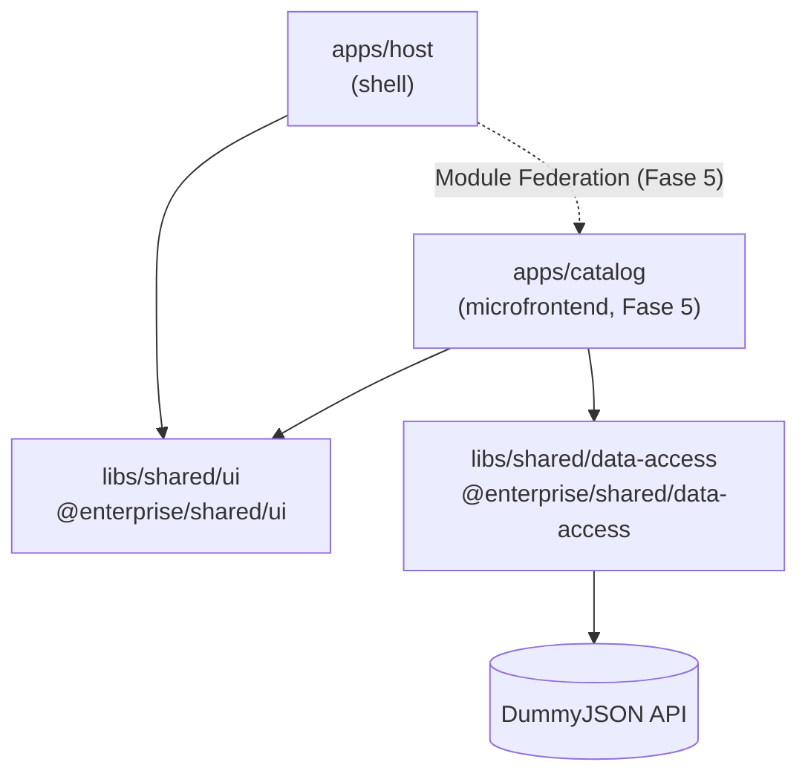

# Enterprise MFE

Monorepo **Nx + Angular** com arquitetura de **microfrontends** (Host + Catalog), consumindo a API pública do [DummyJSON](https://dummyjson.com).

É um projeto de estudo: a ideia é construir, passo a passo, uma base no estilo "enterprise" e registrar **o porquê** de cada decisão, não só o resultado. Cada etapa vira um commit pequeno, e este README é atualizado conforme o projeto avança.

## A ideia

Uma vitrine de produtos dividida em duas aplicações independentes:

- **Host:** a casca da aplicação (layout, navegação). Carrega os microfrontends em tempo de execução.
- **Catalog:** o microfrontend da listagem de produtos, com scroll infinito.

As duas compartilham código por meio de **libs** do monorepo:

- **`shared/data-access`:** acesso à API e estado (RxJS + Signals).
- **`shared/ui`:** Design System, com componentes visuais desacoplados das regras de negócio.



## Stack

| Ferramenta | Versão | Uso |
|---|---|---|
| Nx | 23.3 | Monorepo, geradores, cache e grafo de dependências |
| Angular | 22.1 | Standalone Components, Signals, change detection `OnPush` |
| TypeScript | 6.0 | `strict` ligado nas libs |
| RxJS | 7.8 | Requisições HTTP e controle de concorrência |
| Jest | 30 | Testes unitários |
| Cypress | 16 | Testes e2e |
| Node | 24 | Runtime |

## Estrutura

```
apps/
  host/                  # aplicação shell
  host-e2e/              # testes e2e (Cypress) do host
libs/
  shared/
    ui/                  # @enterprise/shared/ui
    data-access/         # @enterprise/shared/data-access
      src/lib/products/  # modelos e cliente da API de produtos
```

As libs são importadas sempre pelo alias (`@enterprise/...`), nunca por caminho relativo. Os aliases ficam em `paths` no `tsconfig.base.json` e são criados pelos geradores do Nx. Cada lib expõe apenas o que está no seu `src/index.ts`.

## Como rodar

Pré-requisitos: Node 24 e npm.

```bash
npm ci
```

| Tarefa | Comando |
|---|---|
| Servidor de desenvolvimento (http://localhost:4200) | `npx nx serve host` |
| Build de produção | `npx nx build host` |
| Testes do host | `npx nx test host` |
| Testes de uma lib | `npx nx test shared-ui` / `npx nx test shared-data-access` |
| Todos os testes | `npx nx run-many -t test` |
| Lint | `npx nx run-many -t lint` |
| Grafo de dependências | `npx nx graph` |

## Progresso

- [x] **Fase 1: base do workspace.** Workspace Nx criado, componente de exemplo removido, build e testes verdes.
- [x] **Fase 2: libs compartilhadas.** `shared/ui` e `shared/data-access` geradas com o Nx; alias `@enterprise/shared/ui` validado no build, no Jest e no grafo do Nx.
- [ ] **Fase 3: camada de dados** *(em andamento)*
  - [x] Modelos de produto tipados a partir da resposta real da API
  - [x] `ProductsApi`: cliente HTTP paginado, com testes
  - [ ] `ProductsStore`: estado com Signals e scroll infinito
  - [ ] Consumo no host, validando o alias `@enterprise/shared/data-access`
- [ ] **Fase 4: Design System** em `shared/ui`, incluindo a diretiva de scroll infinito.
- [ ] **Fase 5: microfrontend Catalog** integrado ao Host via Module Federation.

## Decisões-chave

### Monorepo e libs
- **Libs não buildable:** o host compila o código-fonte das libs direto, via `paths`. É mais simples para libs internas e facilita o compartilhamento no Module Federation.
- **Geradores do Nx sempre que existirem**, para criar libs e aliases de forma consistente. Os defaults do gerador foram fixados no `nx.json` (Jest, ESLint, SCSS). Na versão instalada, o padrão de testes para libs não buildable seria Vitest, e o monorepo usa Jest.
- **`strict` só nas libs, por enquanto:** código novo já nasce com tipagem rigorosa; ligar o `strict` no restante do workspace é uma tarefa separada.
- **API pública explícita:** o `index.ts` de cada lib usa exports nomeados (`export type` para tipos) em vez de `export *`, para que nada interno vaze por acidente.
- **Webpack no host (em vez de esbuild),** de propósito: é o caminho para o Module Federation da Fase 5.

### Camada de dados (Fase 3)
- **Tipos conferidos contra a API real:** `brand` falta em cerca de metade dos produtos, então é opcional; `availabilityStatus` é um union dos três valores que a API devolve. Todos os campos são `readonly`.
- **`@Service()` em vez de `@Injectable`:** é o padrão do Angular 22. O serviço se registra sozinho na injeção de dependências, e as dependências entram via `inject()`.
- **Sem `provideHttpClient()`:** no Angular 22, o `HttpClient` já é fornecido no root e usa `fetch` por padrão.
- **API e estado separados:** o `ProductsApi` só descreve a requisição (devolve um `Observable` e repassa erros); o `ProductsStore` guarda o estado e decide quando buscar.
- **Scroll infinito com `exhaustMap`:** novos pedidos de "carregar mais" são ignorados enquanto uma carga está em andamento, o que evita páginas perdidas ou duplicadas. O `skip` vem sempre da quantidade de itens já carregados, então uma nova tentativa depois de um erro repete a mesma página.
- **Detectar o fim da rolagem é papel da UI:** um `IntersectionObserver` numa diretiva da `shared/ui`. O store só expõe `loadMore()` e `hasMore()`, e é testável sem DOM.

### Testes
- **Sem rede nos testes:** chamadas HTTP são interceptadas com `HttpTestingController`.
- **Placeholders temporários:** o host renderiza o componente de exemplo da `shared/ui` só para validar o alias; ele sai na Fase 4.
